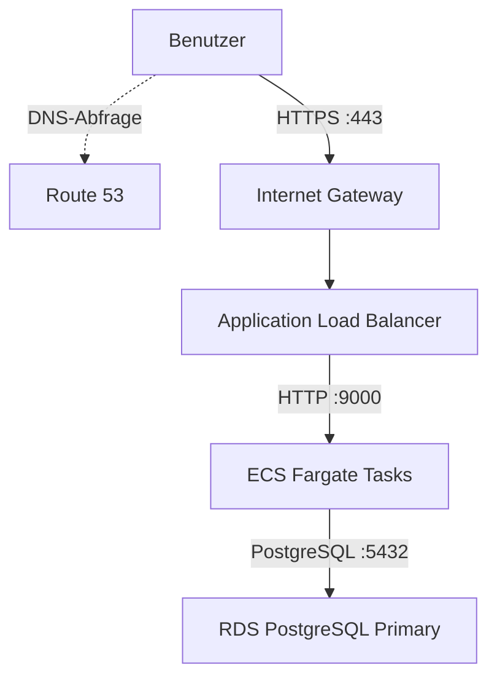
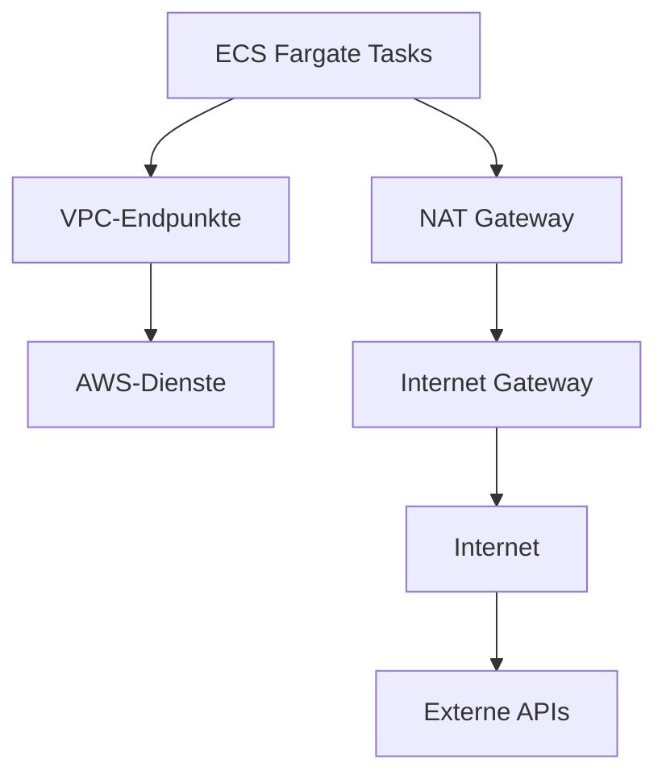
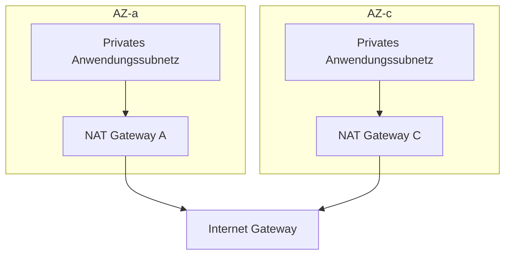

# DEVOPS-001 — Architekturvorschlag für die AWS-Infrastruktur

- **Projekt:** Production Infrastructure Foundation
- **Rolle:** DevOps Engineer
- **Cloud-Anbieter:** Amazon Web Services (AWS)
- **Infrastructure as Code:** Terraform
- **Status:** Architekturentwurf — Unter Vorbehalt genehmigt
- **Bereitstellungsstatus:** Nur Entwurf (nicht bereitgestellt)

## 1. Projektübersicht

### 1.1 Hintergrund

Das Entwicklungsteam plant die Einführung eines neuen REST-API-Dienstes und benötigt dafür eine AWS-Infrastruktur.

Zu Beginn wird ein geringes Datenverkehrsaufkommen erwartet. Dennoch müssen zukünftiges Nutzerwachstum und die Erweiterung des Dienstes berücksichtigt werden.

Das Entwicklungsteam möchte sich außerdem auf die Anwendungsentwicklung konzentrieren. Daher ist es wichtig, eine zuverlässige Betriebsumgebung bereitzustellen und gleichzeitig den Aufwand für den Infrastrukturbetrieb zu minimieren.

### 1.2 Ziele

Ziel dieses Projekts ist es, eine AWS-Infrastruktur unter Berücksichtigung von Verfügbarkeit, Sicherheit, Skalierbarkeit und Kosteneffizienz zu entwerfen und eine Grundlage für die Umsetzung mit Terraform als Infrastructure as Code (IaC) zu schaffen.

Die wichtigsten Entwurfsprinzipien sind:

1. Hohe Verfügbarkeit: Mindestens zwei Availability Zones nutzen, um die Verfügbarkeit zu unterstützen.
2. Sicherheit: Öffentliche und private Subnetze trennen und das Prinzip der minimalen Berechtigungen anwenden.
3. Skalierbarkeit: Eine Architektur bereitstellen, die auf steigenden Datenverkehr reagieren kann.
4. Betriebseffizienz: Verwaltete AWS-Dienste nutzen, um den Betriebsaufwand zu minimieren.
5. Kostenoptimierung: Dienste passend zum anfänglichen Datenverkehrsaufkommen auswählen und unnötige Ressourcen minimieren.
6. Infrastructure as Code: Terraform für eine reproduzierbare Infrastrukturverwaltung einsetzen.

## 2. Architekturübersicht

### 2.1 Gesamtarchitektur

Die vorgeschlagene Infrastruktur erstreckt sich über zwei Availability Zones innerhalb einer AWS VPC.

Jede AZ enthält die folgenden Netzwerkschichten:

| Netzwerkschicht | AZ-a | AZ-c | Zweck |
| --- | --- | --- | --- |
| Öffentliches Subnetz | 10.0.1.0/24 | 10.0.4.0/24 | ALB, NAT Gateway |
| Privates Anwendungssubnetz | 10.0.2.0/24 | 10.0.5.0/24 | ECS Fargate Tasks |
| Privates Datenbanksubnetz | 10.0.3.0/24 | 10.0.6.0/24 | RDS PostgreSQL |
| VPC | 10.0.0.0/16 | Gemeinsame VPC | Gesamtes Netzwerk |

Die Verteilung der Anwendung auf beide AZs verringert das Risiko einer Dienstunterbrechung durch den Ausfall einer einzelnen AZ.

### 2.2 Wesentliche Datenverkehrsflüsse

### Eingehender Datenverkehr

Der ALB terminiert HTTPS-Verbindungen mit einem von ACM verwalteten TLS-Zertifikat.

ECS-Tasks werden in privaten Anwendungssubnetzen ausgeführt und sind nicht direkt über das öffentliche Internet erreichbar.

### Ausgehender Datenverkehr

Für den Zugriff auf AWS-Dienste werden VPC-Endpunkte verwendet, für den Zugriff auf das externe Internet NAT Gateways.

## 3. Auswahl der AWS-Dienste

| Bereich | Ausgewählter Dienst | Hauptzweck |
| --- | --- | --- |
| Netzwerk | Amazon VPC | Netzwerkisolierung |
| Öffentlicher Zugriff | Internet Gateway | Internetanbindung |
| Ausgehender Zugriff | NAT Gateway | Ausgehende Kommunikation aus privaten Subnetzen |
| Private Anbindung | VPC Endpoints | Private Verbindung zu AWS-Diensten |
| Lastverteilung | Application Load Balancer | Verteilung von HTTPS-Anfragen |
| Rechenleistung | Amazon ECS with AWS Fargate | Ausführung von Containeranwendungen |
| Container-Registry | Amazon ECR | Verwaltung von Container-Images |
| Datenbank | Amazon RDS for PostgreSQL | Relationale Datenbank |
| DNS | Amazon Route 53 | Domain- und DNS-Verwaltung |
| TLS-Zertifikat | AWS Certificate Manager | Verwaltung von HTTPS-Zertifikaten |
| Secrets | AWS Secrets Manager | Verwaltung von Datenbankzugangsdaten |
| Konfiguration | AWS Systems Manager Parameter Store | Verwaltung von Anwendungskonfiguration und Secrets |
| Monitoring | Amazon CloudWatch | Logs, Metriken und Benachrichtigungen |
| IAM | AWS IAM | Verwaltung der Zugriffsberechtigungen je Dienst |
| IaC | Terraform | Deklaration und Verwaltung der Infrastruktur |

## 4. Dokumentierte Architekturentscheidungen (Architecture Decision Records)

### ADR-001: Einsatz von Amazon ECS with AWS Fargate

**Entscheidung:** Amazon ECS with AWS Fargate

#### Geprüfte Alternativen

- ECS on EC2
- ECS on Fargate

#### Begründung

#### 1. Minimierung des Betriebsaufwands

Fargate ist ein Dienst, bei dem AWS die zugrunde liegende Recheninfrastruktur für die Ausführung von Containern verwaltet.

Bei ECS auf EC2 müssen Instanzbetrieb, Patching und Kapazitätsverwaltung selbst berücksichtigt werden. Fargate kann diesen Verwaltungsaufwand reduzieren.

Dies entspricht der Anforderung des Entwicklungsteams, sich auf die Anwendungsentwicklung zu konzentrieren.

#### 2. Anfängliches Datenverkehrsaufkommen

Da zu Beginn ein vergleichsweise geringes Datenverkehrsaufkommen erwartet wird, werden die benötigten Task-Ressourcen genutzt, anstatt vorab umfangreiche EC2-Instanzkapazitäten bereitzustellen.

Die Abrechnung von Fargate richtet sich unter anderem nach den zugewiesenen vCPUs, dem Arbeitsspeicher und der Laufzeit.

Bei Workloads mit dauerhaft hoher Auslastung kann EC2 jedoch wirtschaftlicher sein.

#### 3. Skalierbarkeit

Mit ECS Service Auto Scaling lässt sich die Anzahl der Anwendungstasks anpassen.

Fargate ermöglicht die Skalierung der Task-Kapazität, ohne eine EC2 Auto Scaling Group direkt verwalten zu müssen.

#### Vor- und Nachteile

| Vorteile | Nachteile |
| --- | --- |
| Geringerer Betriebsaufwand für die zugrunde liegenden Server | Möglicherweise höhere Kosten bei langfristig gleichbleibenden Workloads |
| Ressourcenverwaltung auf Task-Ebene | Eingeschränkte Kontrolle über den Host im Vergleich zu EC2 |
| Unterstützung für ECS Service Auto Scaling | Task-Startzeiten und Skalierungsrichtlinien müssen berücksichtigt werden |
| Minimierter Betriebsaufwand für das Entwicklungsteam | Ressourcen- und Plattformbeschränkungen von Fargate |

**Endgültige Entscheidung:** ECS Fargate einsetzen.

### ADR-002: Einsatz von Amazon RDS for PostgreSQL

**Entscheidung:** Amazon RDS for PostgreSQL — Multi-AZ DB Instance

#### Geprüfte Alternativen

- Amazon Aurora PostgreSQL-Compatible
- Amazon RDS for PostgreSQL

#### Begründung

#### 1. Anfängliche Dienstgröße

Der aktuell erwartete Datenverkehr ist gering. Es bestehen keine besonderen Anforderungen an einen hohen Lesedurchsatz oder eine umfangreiche Datenskalierung.

Die erweiterten Skalierungsfunktionen von Aurora wurden daher für die Anfangsphase als nicht erforderlich eingestuft.

#### 2. Hohe Verfügbarkeit

Auch RDS PostgreSQL kann durch eine Multi-AZ-Konfiguration eine hohe Verfügbarkeit bieten.

Dabei erfolgt eine synchrone Replikation zwischen der primären Datenbank und einer Standby-Datenbank in einer anderen AZ. Bei einem Ausfall wird ein automatisches Failover unterstützt.

Eine Multi-AZ-Konfiguration garantiert jedoch keinen unterbrechungsfreien Betrieb im Fehlerfall.

#### 3. Kosteneffizienz

Aurora bietet eine höhere Skalierbarkeit und Funktionen für hohe Verfügbarkeit. Abhängig vom Workload und dem gewählten Abrechnungsmodell können jedoch zusätzliche Kosten entstehen.

Für die anfängliche Größe wurde RDS PostgreSQL als voraussichtlich wirtschaftlicher eingeschätzt.

Der genaue Kostenunterschied muss anhand der tatsächlichen Instanzspezifikationen und Datennutzung weiter überprüft werden.

#### 4. Einfacherer Betrieb

RDS und Aurora sind beide von AWS verwaltete Datenbanken und können den Betriebsaufwand gegenüber einem selbst betriebenen PostgreSQL-Server reduzieren.

#### Vor- und Nachteile

| Aspekt | RDS PostgreSQL | Aurora PostgreSQL |
| --- | --- | --- |
| Betriebsmodell | Von AWS verwaltet | Von AWS verwaltet |
| Hohe Verfügbarkeit | Multi-AZ-Unterstützung | HA auf Basis von verteiltem Speicher |
| Leseskalierung | Unterstützung für Read Replicas | Unterstützung für Aurora Replicas |
| Skalierbarkeit | Für typische Dienste ausreichend | Erweiterte Skalierungsfunktionen |
| Kosten | Bei der anfänglichen Größe möglicherweise vorteilhaft | Abhängig von Konfiguration und I/O |
| Geeignete Umgebung | Typische relationale Workloads | Hohe Leistungs- und Skalierungsanforderungen |

**Endgültige Entscheidung:** RDS PostgreSQL Multi-AZ einsetzen.

### ADR-003: Gemeinsamer Einsatz von NAT Gateways und VPC-Endpunkten

**Entscheidung:** NAT Gateway + VPC Endpoints

#### Begründung

Die Anwendung wird in privaten Subnetzen ausgeführt, muss aber bei Bedarf auf das externe Internet zugreifen können.

Die Architektur sieht NAT Gateways vor, damit Ressourcen in privaten Subnetzen auf übliche externe IPv4-Internetdienste zugreifen können.

Zusätzlich wurden VPC-Endpunkte eingeführt, um bei der Kommunikation mit AWS-Diensten wie ECR und Parameter Store unnötigen Datenverkehr über NAT Gateways zu reduzieren.

#### NAT-Gateway-Konzept

In jeder AZ wird ein NAT Gateway vorgesehen.

Diese Struktur verringert die Abhängigkeit von einem NAT Gateway in einer bestimmten AZ und minimiert den Datentransfer zwischen AZs.

Der Betrieb von zwei NAT Gateways erhöht jedoch die Kosten.

#### VPC-Endpunkt-Konzept

| AWS-Dienst | Endpunkttyp |
| --- | --- |
| ECR API | Interface |
| ECR DKR | Interface |
| Amazon S3 | Gateway |
| Systems Manager | Interface |
| Secrets Manager | Interface |
| CloudWatch Logs | Interface |

Für das Herunterladen von ECR-Images aus privaten Subnetzen wurden ECR-API-, ECR-DKR- und S3-Endpunkte berücksichtigt.

Die tatsächliche Endpunktkonfiguration wird anhand der Ausführungsweise der Anwendung und der benötigten AWS-API-Zugriffe festgelegt.

#### Vor- und Nachteile

- NAT Gateways unterstützen die Kommunikation mit zahlreichen externen IPv4-Zielen. Dabei fallen jedoch zeitabhängige Gebühren und Kosten für die verarbeitete Datenmenge an.
- VPC-Endpunkte ermöglichen den privaten Zugriff auf unterstützte AWS-Dienste. Dienstspezifische Konfigurationen und Kosten müssen dabei berücksichtigt werden.
- Auch für Interface-Endpunkte fallen stündliche Gebühren und Kosten für die Datenverarbeitung an. Daher sind sie nicht grundsätzlich günstiger als NAT.

**Endgültige Entscheidung:** Ein NAT Gateway je AZ zusammen mit den erforderlichen VPC-Endpunkten verwenden.

### ADR-004: Trennung der Aufgaben von Secrets Manager und Parameter Store

**Entscheidung:** Dienste nach Anforderungen an die Secret-Rotation und nach Dateneigenschaften trennen.

#### AWS Secrets Manager

Verwaltung sensibler Informationen, deren Zugangsdaten regelmäßig rotiert werden müssen.

Ein typisches Beispiel sind die Datenbankzugangsdaten für RDS PostgreSQL.

#### AWS Systems Manager Parameter Store

Speicherung von Anwendungskonfigurationswerten und Secrets ohne gesonderte Anforderung an eine automatische Rotation.

Für sensible Informationen wird SecureString verwendet.

#### Begründung

Die automatische Rotation von Secrets Manager wird dort eingesetzt, wo sie benötigt wird. Die übrigen Konfigurationswerte werden in Parameter Store verwaltet, um Kosten und Betriebskomplexität zu steuern.

#### Sicherheitsaspekte

Beim Umgang mit Secrets in Terraform ist Vorsicht erforderlich, da ihre Werte im Terraform-State gespeichert werden können.

Auch die Nutzung der von RDS verwalteten Masterpasswörter wird in Betracht gezogen.

Für die Anwendung wird ein separates Datenbankkonto mit minimalen Berechtigungen empfohlen.

**Endgültige Entscheidung:** Secrets Manager für Datenbankzugangsdaten verwenden, Parameter Store für Anwendungskonfiguration und ausgewählte Secrets.

## 5. Netzwerk- und Sicherheitskonzept

### 5.1 Netzwerksegmentierung

Das Netzwerk innerhalb der VPC wird in drei Schichten aufgeteilt.

| Subnetz | Öffentlicher Zugriff | Aufgabe |
| --- | --- | --- |
| Öffentlich | Erlaubt | ALB, NAT Gateway |
| Private Anwendung | Kein direkter Zugriff | ECS Fargate |
| Private Datenbank | Kein direkter Zugriff | RDS PostgreSQL |

Öffentliche Subnetze können eine Route zum Internet Gateway haben.

Private Anwendungssubnetze nutzen NAT Gateways für die erforderliche ausgehende Internetkommunikation.

Private Datenbanksubnetze benötigen grundsätzlich keinen Internetzugriff. Daher sieht der Entwurf keine unnötigen Internetrouten vor.

### 5.2 Security Groups

### ALB Security Group

| Richtung | Protokoll | Port | Quelle/Ziel |
| --- | --- | --- | --- |
| Eingehend | TCP | 443 | 0.0.0.0/0 |
| Ausgehend | TCP | 9000 | ECS SG |

### ECS Security Group

| Richtung | Protokoll | Port | Quelle/Ziel |
| --- | --- | --- | --- |
| Eingehend | TCP | 9000 | ALB SG |
| Ausgehend | TCP | 5432 | RDS SG |
| Ausgehend | TCP | 443 | Erforderliche AWS-Dienste und externe APIs |

### RDS Security Group

| Richtung | Protokoll | Port | Quelle/Ziel |
| --- | --- | --- | --- |
| Eingehend | TCP | 5432 | ECS SG |

Eine separate Security Group für Interface-VPC-Endpunkte erlaubt HTTPS-Verbindungen auf Port 443 von den ECS-Tasks, die Zugriff benötigen.

Die tatsächliche Erreichbarkeit hängt neben Security Groups auch von Routingtabellen, IAM und dienstspezifischen Einstellungen ab.

## 6. Verfügbarkeit und Skalierbarkeit

### Anwendungsschicht

- ECS-Fargate-Tasks auf zwei AZs verteilen.
- Einen einzelnen ECS Service verwenden.
- Den anfänglichen Desired Count auf 2 setzen.
- Health Checks der ALB Target Group verwenden.
- Die Einführung von ECS Service Auto Scaling in Betracht ziehen.

Wenn ein Task ausfällt, versucht der ECS Service, die gewünschte Task-Anzahl aufrechtzuerhalten. Der ALB leitet Datenverkehr anhand der Health-Check-Ergebnisse weiter.

Ein Desired Count von 2 allein garantiert jedoch nicht, dass in jeder AZ genau ein Task platziert wird. Die Konfiguration muss daher die Verteilung auf die AZs berücksichtigen.

### Datenbankschicht

- RDS PostgreSQL Multi-AZ DB Instance
- Primary-/Standby-Konfiguration
- Synchrone Datenreplikation
- Automatisches Failover bei einem Ausfall
- Die Anwendung verwendet einen gemeinsamen RDS-Endpunkt.

Die Standby-Datenbank wird in einer typischen Multi-AZ-DB-Instance-Konfiguration nicht für Lesezugriffe verwendet.

## 7. Monitoring und Observability

**Ausgewählter Dienst:** Amazon CloudWatch

Das anfängliche Monitoring wird auf Basis von CloudWatch konzipiert.

| Ziel | Überwachte Größen |
| --- | --- |
| ALB | Anzahl der Anfragen, Antwortzeit der Targets, HTTP 5xx |
| ECS | CPU, Arbeitsspeicher, Anzahl laufender Tasks |
| RDS | CPU, Verbindungen, freier Speicherplatz, Lese-/Schreiblatenz |
| Anwendung | Anwendungslogs, Fehlerlogs |
| Infrastruktur | CloudWatch-Metriken und -Alarme |

Damit wird eine Grundlage geschaffen, um bei Störungen die Logs und Metriken wichtiger Dienste zu prüfen und Probleme zu analysieren.

Die tatsächlichen Alarmschwellenwerte werden nach Prüfung der Diensteigenschaften und der Metriken im Normalbetrieb angepasst.

## 8. Kostenbetrachtung

Obwohl die Architektur von einer Produktionsumgebung ausgeht, dient das Projekt dem persönlichen Lernen und dem Aufbau eines Portfolios.

Grundsätzlich wird daher nur bis zur Terraform-Plan-Phase validiert, ohne tatsächlich kostenpflichtige AWS-Ressourcen bereitzustellen.

### Wesentliche Kostentreiber

| Dienst | Kostenaspekte |
| --- | --- |
| NAT Gateway | Stündliche Gebühren und Datenverarbeitung |
| ALB | Stündliche Gebühren und LCU-Kosten |
| ECS Fargate | vCPU, Arbeitsspeicher und Laufzeit |
| RDS PostgreSQL | DB-Instanz, Speicher und Multi-AZ |
| VPC Interface Endpoint | Stündliche Gebühren und Datenverarbeitung |
| Secrets Manager | Speicherung von Secrets und API-Anfragen |
| CloudWatch | Logs, Metriken und Alarme |
| Route 53 | Hosted Zones und DNS-Abfragen |

### Strategien zur Kostenoptimierung

- Verwaltete Dienste passend zur anfänglichen Dienstgröße auswählen.
- RDS PostgreSQL anstelle von Aurora wählen.
- VPC-Endpunkte nur für die erforderlichen AWS-Dienste verwenden.
- Die Kosten von NAT Gateways gegen die hohe Verfügbarkeit über mehrere AZs abwägen.
- Die Einführung unnötiger AWS-Dienste vermeiden.
- Vorab validieren, ohne Terraform apply auszuführen.

Das Ziel dieses Entwurfs ist eine angemessene Kostensteuerung bei gleichzeitiger Stabilität und Betriebseffizienz einer Produktionsumgebung. Die reine Kostenminimierung steht nicht allein im Vordergrund.

## 9. Architekturprüfung und Verbesserungen

Nach dem ersten Architekturentwurf wurde die Struktur durch schrittweise Reviews verbessert.

| Version | Wesentliche Änderungen |
| --- | --- |
| v1 | Ursprünglicher Entwurf auf Basis von VPC, ALB, ECS, Aurora und NAT |
| v2 | VPC-Endpunkte eingeführt und NAT-Datenverkehrswege verbessert |
| v3 | Multi-AZ-Netzwerk, ein NAT Gateway je AZ und Datenbank-HA berücksichtigt |
| v4 | ECS-Konfiguration präzisiert sowie Security Groups und Monitoring ergänzt |
| Final (Pending) | Darstellung der Beziehung zwischen Route 53 und ACM, des RDS-Endpunkts und des NAT-Routings präzisieren |

### Wesentliche Verbesserungen

#### 1. Multi-AZ-Architektur

Im ursprünglichen Entwurf waren die Netzwerk- und Ressourcenplatzierung je AZ nicht eindeutig festgelegt.

Der Entwurf wurde dahingehend verbessert, dass in beiden AZs jeweils öffentliche Subnetze, private Anwendungssubnetze und private Datenbanksubnetze vorgesehen sind.

#### 2. Security-Group-Konzept

Der ursprüngliche Ansatz, Zugriffe anhand von Subnetz-CIDR-Bereichen zu kontrollieren, wurde verbessert. Kommunikationsberechtigungen werden nun vorrangig über Referenzen zwischen Security Groups definiert.

#### 3. Private Anbindung

Das ursprüngliche Diagramm enthielt keine VPC-Endpunkte. Daher war die Kommunikation mit AWS-Diensten aus privaten Subnetzen von NAT Gateways abhängig.

Durch das Ergänzen von VPC-Endpunkten im Diagramm wurden private Verbindungen und Möglichkeiten zur Kostenoptimierung geschaffen.

#### 4. Darstellung logischer Ressourcen

Das ursprüngliche Diagramm stellte IGWs und ALBs so dar, als existierten sie separat in jeder AZ. Die Darstellung wurde verbessert, um die tatsächliche logische Struktur der AWS-Ressourcen von ihrer Platzierung über die AZs hinweg zu unterscheiden.

## 10. Fazit

Diese Architektur wurde für die anfängliche Betriebsumgebung eines neuen REST-API-Dienstes entworfen.

Sie verteilt Netzwerk und Anwendung auf zwei Availability Zones und nutzt ECS Fargate sowie RDS PostgreSQL Multi-AZ, um den Aufwand für den Infrastrukturbetrieb zu reduzieren und gleichzeitig die Verfügbarkeit zu unterstützen.

Darüber hinaus berücksichtigt sie die Trennung öffentlicher und privater Netzwerke, die Zugriffskontrolle über Security Groups, die Verwaltung sensibler Informationen mit Secrets Manager und Parameter Store sowie Kommunikationsrichtlinien mithilfe von NAT Gateways und VPC-Endpunkten.

Bei der Technologieauswahl wurden aktuelle Dienstanforderungen, erwartete Größe, Verfügbarkeit, Betriebsaufwand und Kosten gegeneinander abgewogen, anstatt hohe Leistung oder komplexe Konfigurationen grundsätzlich zu bevorzugen.

Im nächsten Schritt wird dieser Entwurf mit Terraform umgesetzt. Anschließend werden die Ergebnisse der statischen Validierung und der Ausführungsplan geprüft, ohne tatsächliche Ressourcen bereitzustellen.
