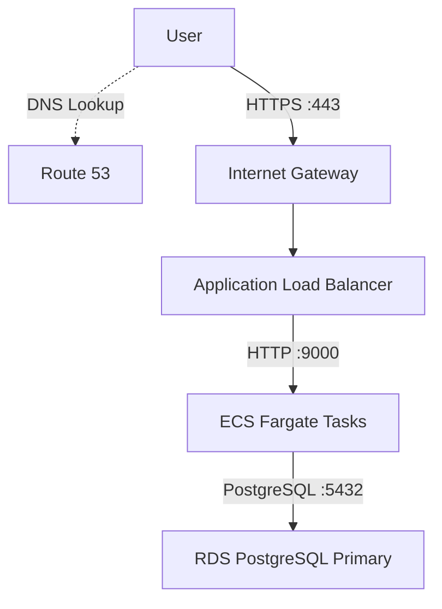
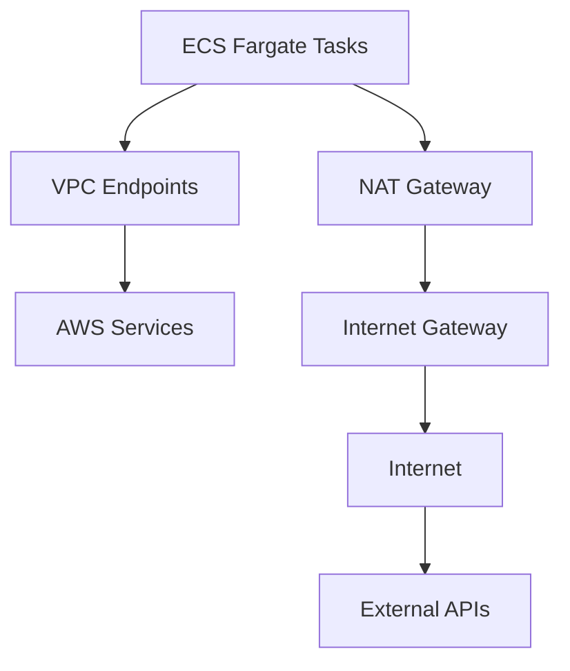
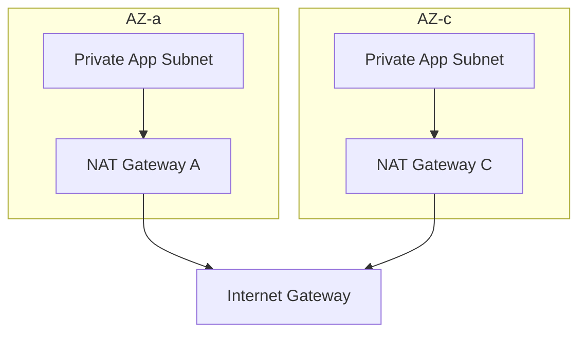

# DEVOPS-001 — AWS Infrastructure Architecture Proposal

- **Project:** Production Infrastructure Foundation
- **Role:** DevOps Engineer
- **Cloud Provider:** Amazon Web Services (AWS)
- **Infrastructure as Code:** Terraform
- **Status:** Architecture Design — Conditionally Approved
- **Deployment Status:** Design Only (Not Deployed)

## 1. 프로젝트 개요 (Overview)

### 1.1 배경

개발팀에서 신규 REST API 서비스를 출시할 예정이며, 이를 위한 AWS 기반 인프라 구축이 필요합니다.

서비스는 초기 트래픽이 크지 않을 것으로 예상되지만, 향후 사용자 증가와 서비스 확장을 고려해야 합니다.

또한 개발팀은 애플리케이션 개발에 집중하기를 원하므로, 인프라 운영 부담을 최소화하면서 안정적인 서비스 환경을 제공하는 것이 중요합니다.

### 1.2 목표

본 프로젝트의 목표는 가용성, 보안, 확장성, 비용 효율성을 고려한 AWS 인프라를 설계하고 Terraform 기반 IaC로 구현할 수 있는 기반을 마련하는 것입니다.

주요 설계 원칙은 다음과 같습니다.

1. High Availability: 최소 2개 Availability Zone을 활용한 가용성 확보
2. Security: Public/Private Subnet 분리 및 최소 권한 원칙 적용
3. Scalability: 서비스 트래픽 증가에 대응할 수 있는 구조
4. Operational Efficiency: AWS 관리형 서비스를 활용하여 운영 부담 최소화
5. Cost Optimization: 초기 트래픽 규모에 적합한 서비스 선정 및 불필요한 리소스 최소화
6. Infrastructure as Code: Terraform을 활용한 재현 가능한 인프라 관리

## 2. 아키텍처 개요 (Architecture Overview)

### 2.1 전체 아키텍처

제안한 인프라는 AWS VPC 내 2개 Availability Zone을 기반으로 구성됩니다.

각 AZ는 다음과 같은 네트워크 계층을 갖습니다.

| Network Layer | AZ-a | AZ-c | 용도 |
| --- | --- | --- | --- |
| Public Subnet | 10.0.1.0/24 | 10.0.4.0/24 | ALB, NAT Gateway |
| Private App Subnet | 10.0.2.0/24 | 10.0.5.0/24 | ECS Fargate Tasks |
| Private DB Subnet | 10.0.3.0/24 | 10.0.6.0/24 | RDS PostgreSQL |
| VPC | 10.0.0.0/16 | 공통 VPC | 전체 네트워크 |

두 AZ에 애플리케이션을 분산하여 단일 AZ 장애로 인한 서비스 중단 가능성을 낮춥니다.

### 2.2 주요 트래픽 흐름

### Inbound Traffic

ALB는 ACM에서 관리하는 TLS 인증서를 이용해 HTTPS 연결을 종료합니다.

ECS Task는 Private App Subnet에서 실행되며 외부 인터넷에 직접 노출되지 않습니다.

### Outbound Traffic

AWS 서비스 접근에는 VPC Endpoint를 활용하고, 외부 인터넷 접근에는 NAT Gateway를 사용합니다.

## 3. AWS 서비스 선정안 (Technology Selection)

| 영역 | 선정 서비스 | 주요 목적 |
| --- | --- | --- |
| Networking | Amazon VPC | 네트워크 격리 |
| Public Access | Internet Gateway | 인터넷 연결 |
| Outbound Access | NAT Gateway | Private Subnet의 외부 통신 |
| Private Connectivity | VPC Endpoints | AWS 서비스에 대한 사설 연결 |
| Load Balancing | Application Load Balancer | HTTPS 요청 분산 |
| Compute | Amazon ECS with AWS Fargate | 컨테이너 애플리케이션 실행 |
| Container Registry | Amazon ECR | 컨테이너 이미지 관리 |
| Database | Amazon RDS for PostgreSQL | 관계형 데이터베이스 |
| DNS | Amazon Route 53 | 도메인 및 DNS 관리 |
| TLS Certificate | AWS Certificate Manager | HTTPS 인증서 관리 |
| Secrets | AWS Secrets Manager | DB Credential 관리 |
| Configuration | AWS Systems Manager Parameter Store | 애플리케이션 설정 및 Secret 관리 |
| Monitoring | Amazon CloudWatch | 로그, 메트릭 및 알림 |
| IAM | AWS IAM | 서비스별 접근 권한 관리 |
| IaC | Terraform | 인프라 선언 및 관리 |

## 4. 주요 아키텍처 의사결정 (Architecture Decision Records)

### ADR-001: Amazon ECS with AWS Fargate 채택

**Decision:** Amazon ECS with AWS Fargate

#### 검토한 대안

- ECS on EC2
- ECS on Fargate

#### 선정 이유

#### 1. 운영 부담 최소화

Fargate는 AWS가 컨테이너 실행에 필요한 기반 컴퓨팅 인프라를 관리하는 서비스입니다.

EC2 기반 ECS에서는 인스턴스 운영, 패치 및 Capacity 관리 등을 직접 고려해야 하지만, Fargate는 이러한 관리 부담을 줄일 수 있습니다.

개발팀이 애플리케이션 개발에 집중하기를 원하는 요구사항에 적합합니다.

#### 2. 초기 트래픽 규모

초기에는 비교적 적은 트래픽이 예상되므로 대규모 EC2 인스턴스 용량을 사전에 확보하기보다는 필요한 Task 리소스를 사용하는 방식을 선택했습니다.

Fargate는 할당된 vCPU 및 메모리와 실행 시간 등에 따라 과금됩니다.

다만 지속적으로 높은 사용률을 유지하는 워크로드에서는 EC2가 더 경제적일 수 있습니다.

#### 3. 확장성

ECS Service Auto Scaling을 활용하여 애플리케이션 Task 수를 조정할 수 있습니다.

Fargate에서는 EC2 Auto Scaling Group을 직접 관리하지 않고 Task 용량을 확장할 수 있습니다.

#### Trade-offs

| 장점 | 단점 |
| --- | --- |
| 기반 서버 운영 부담 감소 | 장시간 고정 워크로드에서 비용 증가 가능 |
| Task 단위 리소스 관리 | EC2 대비 호스트 제어 제한 |
| ECS Service Auto Scaling 지원 | Task 시작 시간 및 Scaling 정책 고려 필요 |
| 개발팀의 운영 부담 최소화 | Fargate 리소스 및 플랫폼 제약 존재 |

**Final Decision:** ECS Fargate 채택

### ADR-002: Amazon RDS for PostgreSQL 채택

**Decision:** Amazon RDS for PostgreSQL — Multi-AZ DB Instance

#### 검토한 대안

- Amazon Aurora PostgreSQL-Compatible
- Amazon RDS for PostgreSQL

#### 선정 이유

#### 1. 초기 서비스 규모

현재 예상 트래픽이 크지 않고, 특별히 높은 읽기 처리량이나 대규모 데이터 확장 요구사항이 존재하지 않습니다.

따라서 Aurora의 고급 확장 기능이 초기 단계에서 필수적이지 않다고 판단했습니다.

#### 2. 고가용성

RDS PostgreSQL에서도 Multi-AZ 구성을 활용하여 고가용성을 확보할 수 있습니다.

Primary DB와 다른 AZ에 위치한 Standby DB 간 동기식 복제를 사용하며, 장애 발생 시 자동 Failover를 지원합니다.

단, Multi-AZ 구성은 장애 시 무중단 운영을 보장하는 것은 아닙니다.

#### 3. 비용 효율성

Aurora는 더 높은 확장성과 고가용성 기능을 제공하지만, 워크로드와 선택한 과금 모델에 따라 추가 비용이 발생할 수 있습니다.

초기 규모에서는 RDS PostgreSQL이 상대적으로 경제적일 가능성이 높다고 판단했습니다.

정확한 비용 차이는 실제 인스턴스 사양과 데이터 사용량을 기준으로 추가 검증이 필요합니다.

#### 4. 운영 편의성

RDS와 Aurora 모두 AWS 관리형 데이터베이스이므로 자체 PostgreSQL 서버를 운영하는 것보다 관리 부담을 줄일 수 있습니다.

#### Trade-offs

| 항목 | RDS PostgreSQL | Aurora PostgreSQL |
| --- | --- | --- |
| 운영 방식 | AWS Managed | AWS Managed |
| 고가용성 | Multi-AZ 지원 | 분산 스토리지 기반 HA |
| 읽기 확장 | Read Replica 지원 | Aurora Replica 지원 |
| 확장성 | 일반적인 서비스에 충분 | 고급 확장 기능 |
| 비용 | 초기 규모에서 유리할 가능성 | 구성 및 I/O에 따라 달라짐 |
| 적합한 환경 | 일반적인 관계형 워크로드 | 높은 성능 및 확장 요구 |

**Final Decision:** RDS PostgreSQL Multi-AZ 채택

### ADR-003: NAT Gateway와 VPC Endpoint 병행 사용

**Decision:** NAT Gateway + VPC Endpoints

#### 선정 이유

애플리케이션은 Private Subnet에서 실행되지만, 필요에 따라 외부 인터넷에 접근할 수 있어야 합니다.

Private Subnet의 리소스가 일반적인 외부 IPv4 인터넷 서비스에 접근하기 위해 NAT Gateway를 사용하도록 설계했습니다.

동시에 ECR, Parameter Store 등 AWS 서비스와 통신할 때 불필요한 NAT 경유를 줄이기 위해 VPC Endpoint를 도입했습니다.

#### NAT Gateway 설계

각 AZ에 NAT Gateway 하나씩 배치합니다.

이 구조를 통해 특정 AZ의 NAT Gateway에 대한 의존성을 줄이고 AZ 간 데이터 전송을 최소화합니다.

단, NAT Gateway가 2개이므로 운영 비용은 증가합니다.

#### VPC Endpoint 설계

| AWS Service | Endpoint Type |
| --- | --- |
| ECR API | Interface |
| ECR DKR | Interface |
| Amazon S3 | Gateway |
| Systems Manager | Interface |
| Secrets Manager | Interface |
| CloudWatch Logs | Interface |

ECR 이미지를 Private Subnet에서 다운로드하기 위해 ECR API, ECR DKR, S3 Endpoint를 고려했습니다.

실제 Endpoint 구성은 애플리케이션 실행 방식과 필요한 AWS API 접근을 기준으로 확정합니다.

#### Trade-offs

- NAT Gateway는 다양한 외부 IPv4 목적지로의 통신을 지원하지만 시간 및 데이터 처리량에 따른 비용이 발생합니다.
- VPC Endpoint는 지원되는 AWS 서비스에 사설 경로로 접근할 수 있지만 서비스별 구성과 비용을 고려해야 합니다.
- Interface Endpoint에도 시간 및 데이터 처리 요금이 발생하므로 NAT 대비 항상 저렴한 것은 아닙니다.

**Final Decision:** AZ별 NAT Gateway와 필요한 VPC Endpoint를 병행 사용

### ADR-004: Secrets Manager와 Parameter Store의 역할 분리

**Decision:** Secret Rotation 필요성과 데이터 특성에 따라 서비스 분리

#### AWS Secrets Manager

주기적인 Credential Rotation이 필요한 민감 정보를 관리합니다.

대표적으로 RDS PostgreSQL의 DB Credential을 관리합니다.

#### AWS Systems Manager Parameter Store

애플리케이션 설정값과 별도의 자동 Rotation 요구사항이 없는 Secret을 저장합니다.

민감 정보는 SecureString을 사용합니다.

#### 선정 이유

Secrets Manager의 자동 Rotation 기능을 필요한 영역에 활용하면서, 나머지 설정값은 Parameter Store로 관리하여 비용과 운영 복잡성을 조절합니다.

#### 보안 고려사항

Terraform에서 Secret을 다룰 경우 값이 Terraform State에 저장될 수 있으므로 주의해야 합니다.

RDS 관리형 마스터 비밀번호 기능을 활용하는 방법도 고려합니다.

애플리케이션은 별도의 최소 권한 DB 계정을 사용하는 것을 권장합니다.

**Final Decision:** DB Credential은 Secrets Manager, 애플리케이션 설정과 일부 Secret은 Parameter Store 사용

## 5. 네트워크 및 보안 설계 (Network & Security)

### 5.1 Network Segmentation

VPC 내부 네트워크를 세 계층으로 분리합니다.

| Subnet | Public Access | 역할 |
| --- | --- | --- |
| Public | 허용 | ALB, NAT Gateway |
| Private App | 직접 접근 불가 | ECS Fargate |
| Private DB | 직접 접근 불가 | RDS PostgreSQL |

Public Subnet은 Internet Gateway로 향하는 경로를 가질 수 있습니다.

Private App Subnet은 필요한 외부 인터넷 통신에 NAT Gateway를 활용합니다.

Private DB Subnet은 인터넷 접근을 기본적으로 요구하지 않으므로 불필요한 인터넷 경로를 구성하지 않는 방향으로 설계합니다.

### 5.2 Security Groups

### ALB Security Group

| Direction | Protocol | Port | Source/Destination |
| --- | --- | --- | --- |
| Inbound | TCP | 443 | 0.0.0.0/0 |
| Outbound | TCP | 9000 | ECS SG |

### ECS Security Group

| Direction | Protocol | Port | Source/Destination |
| --- | --- | --- | --- |
| Inbound | TCP | 9000 | ALB SG |
| Outbound | TCP | 5432 | RDS SG |
| Outbound | TCP | 443 | 필요한 AWS 서비스 및 외부 API |

### RDS Security Group

| Direction | Protocol | Port | Source/Destination |
| --- | --- | --- | --- |
| Inbound | TCP | 5432 | ECS SG |

Interface VPC Endpoint용 Security Group은 필요한 ECS Task로부터 HTTPS 443 연결을 허용하도록 별도로 구성합니다.

실제 통신 가능 여부는 Security Group뿐 아니라 Route Table, IAM 및 서비스별 설정에 따라 결정됩니다.

## 6. 고가용성 및 확장성 (Availability & Scalability)

### Application Tier

- ECS Fargate Task를 2개 AZ에 분산
- 단일 ECS Service 사용
- 초기 Desired Count 2개
- ALB Target Group Health Check 사용
- ECS Service Auto Scaling 도입 고려

특정 Task가 장애를 일으키면 ECS Service가 원하는 Task 수를 유지하도록 동작하며, ALB는 Health Check 결과를 기반으로 트래픽을 전달합니다.

다만 Desired Count 2개만으로 특정 AZ에 Task가 반드시 하나씩 배치되는 것은 아니므로 AZ 분산을 고려한 구성이 필요합니다.

### Database Tier

- RDS PostgreSQL Multi-AZ DB Instance
- Primary / Standby 구성
- 동기식 데이터 복제
- 장애 발생 시 자동 Failover
- 애플리케이션은 공통 RDS Endpoint 사용

Standby DB는 일반적인 Multi-AZ DB Instance 구성에서 읽기 트래픽 처리용으로 사용하지 않습니다.

## 7. Monitoring & Observability

**Selected Service:** Amazon CloudWatch

초기 모니터링은 CloudWatch 중심으로 설계합니다.

| 대상 | 모니터링 항목 |
| --- | --- |
| ALB | Request Count, Target Response Time, HTTP 5xx |
| ECS | CPU, Memory, Running Task Count |
| RDS | CPU, Connections, Free Storage, Read/Write Latency |
| Application | Application Logs, Error Logs |
| Infrastructure | CloudWatch Metrics 및 Alarms |

장애 발생 시 주요 서비스의 로그 및 메트릭을 확인하고 문제를 분석할 수 있는 기반을 마련합니다.

실제 Alarm Threshold는 서비스 특성과 정상 상태의 메트릭을 확인한 뒤 조정할 예정입니다.

## 8. 비용 고려사항 (Cost Considerations)

본 아키텍처는 Production 환경을 가정한 설계이지만, 프로젝트는 개인 학습 및 포트폴리오 목적으로 진행됩니다.

따라서 실제 유료 AWS 리소스를 배포하지 않고 Terraform Plan 단계까지 검증하는 것을 기본 원칙으로 합니다.

### 주요 비용 발생 요소

| 서비스 | 비용 고려사항 |
| --- | --- |
| NAT Gateway | 시간당 및 데이터 처리 비용 |
| ALB | 시간당 및 LCU 비용 |
| ECS Fargate | vCPU, Memory, 실행 시간 |
| RDS PostgreSQL | DB Instance, Storage, Multi-AZ |
| VPC Interface Endpoint | 시간당 및 데이터 처리 비용 |
| Secrets Manager | Secret 저장 및 API 요청 |
| CloudWatch | Logs, Metrics, Alarms |
| Route 53 | Hosted Zone 및 DNS Query |

### 비용 최적화 전략

- 초기 서비스 규모에 맞는 관리형 서비스 선정
- Aurora 대신 RDS PostgreSQL 선택
- 필요한 AWS 서비스에 대해서만 VPC Endpoint 사용
- NAT Gateway의 AZ별 HA 구성과 비용 간 균형 고려
- 불필요한 AWS 서비스 도입 방지
- Terraform apply 없이 사전 검증 수행

본 설계는 비용 최소화만을 목표로 하지 않으며, Production 환경의 안정성과 운영 효율성을 유지하면서 비용을 합리적으로 관리하는 것을 목표로 합니다.

## 9. 설계 검토 및 개선 과정 (Architecture Review)

초기 아키텍처를 작성한 후 단계별 리뷰를 진행하여 구조를 개선했습니다.

| Version | 주요 변경사항 |
| --- | --- |
| v1 | VPC, ALB, ECS, Aurora, NAT 기반 초기 설계 |
| v2 | VPC Endpoint 도입, NAT 트래픽 경로 개선 |
| v3 | Multi-AZ 네트워크 구성, AZ별 NAT Gateway, DB HA 반영 |
| v4 | ECS 구성 명확화, Security Group 및 모니터링 추가 |
| Final (Pending) | Route 53/ACM 관계, RDS Endpoint 및 NAT Routing 표현 보완 |

### 주요 개선 내용

#### 1. Multi-AZ Architecture

초기 설계에서는 AZ별 네트워크 및 리소스 배치가 명확하지 않았습니다.

이를 개선하여 2개 AZ에 Public, Private App, Private DB Subnet을 각각 배치하도록 변경했습니다.

#### 2. Security Group Design

Subnet CIDR 범위를 기준으로 접근을 제어하던 초기 접근 방식을 개선하여 Security Group 간 참조를 중심으로 통신 권한을 정의했습니다.

#### 3. Private Connectivity

초기 다이어그램에는 VPC Endpoint가 없어서 Private Subnet의 AWS 서비스 통신을 NAT Gateway에 의존하는 구조였습니다.

이를 개선하여 다이어그램에 VPC Endpoint를 추가함으로써 사설 연결과 비용 최적화 가능성을 확보했습니다.

#### 4. Logical Resource Representation

AZ별로 IGW와 ALB가 각각 존재하는 것처럼 표현했던 초기 다이어그램을 개선하여, 실제 AWS 리소스의 논리적 구성과 AZ별 배치를 구분했습니다.

## 10. 결론 (Conclusion)

이번 아키텍처는 신규 REST API 서비스의 초기 운영 환경을 위해 설계되었습니다.

2개 Availability Zone에 네트워크와 애플리케이션을 분산하고, ECS Fargate와 RDS PostgreSQL Multi-AZ를 활용하여 인프라 운영 부담을 줄이면서 가용성을 확보하는 방향으로 구성했습니다.

또한 Public/Private 네트워크 분리, Security Group 기반 접근 제어, Secrets Manager 및 Parameter Store를 활용한 민감 정보 관리, NAT Gateway와 VPC Endpoint를 통한 네트워크 통신 정책을 적용했습니다.

기술 선정 과정에서는 고성능이나 복잡한 구성을 무조건 우선하기보다 현재 서비스 요구사항과 예상 규모, 가용성, 운영 부담, 비용 간의 균형을 고려했습니다.

다음 단계에서는 본 설계를 Terraform으로 구현하고, 실제 리소스를 배포하지 않은 상태에서 정적 검증과 실행 계획을 확인할 예정입니다.