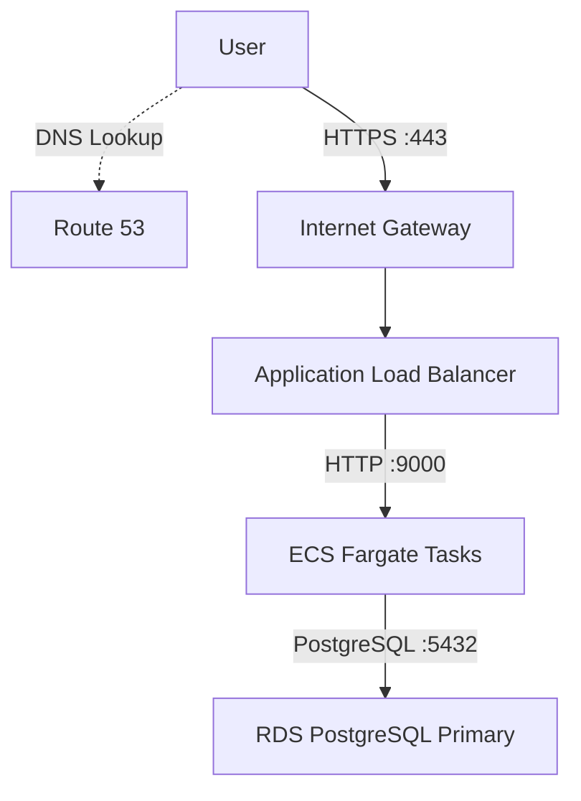
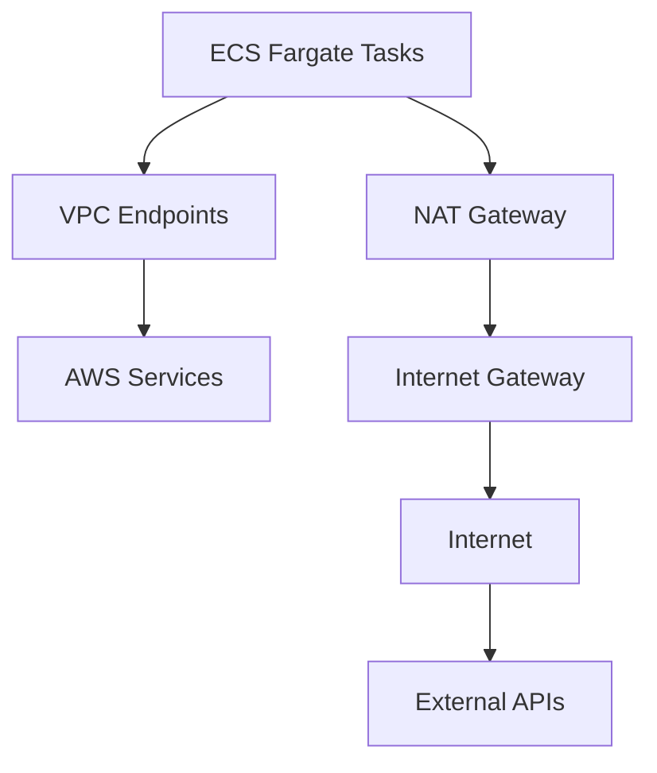
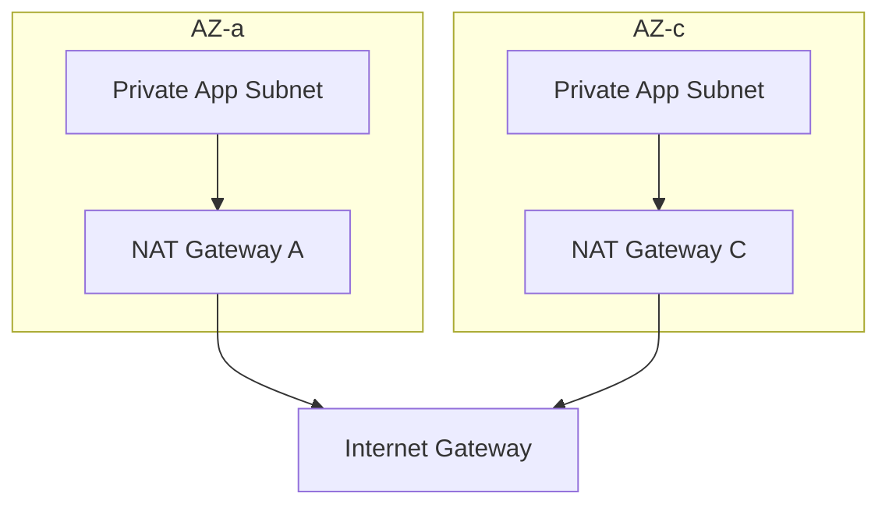

# DEVOPS-001 — AWS Infrastructure Architecture Proposal

**Language:** **[English](architecture-proposal.md)** | [한국어](architecture-proposal.ko.md) | [Deutsch](architecture-proposal.de.md)

- **Project:** Production Infrastructure Foundation
- **Role:** DevOps Engineer
- **Cloud Provider:** Amazon Web Services (AWS)
- **Infrastructure as Code:** Terraform
- **Status:** Architecture Design — Conditionally Approved
- **Deployment Status:** Design Only (Not Deployed)

## 1. Project Overview

### 1.1 Background

The development team plans to launch a new REST API service and needs AWS infrastructure to support it.

Initial traffic is expected to be low, but the architecture must accommodate future user growth and service expansion.

The development team also wants to focus on application development, making it important to provide a reliable service environment while minimizing infrastructure operations overhead.

### 1.2 Objectives

The objective of this project is to design AWS infrastructure that balances availability, security, scalability, and cost efficiency, and to establish a foundation for implementation using Terraform-based Infrastructure as Code (IaC).

The main design principles are:

1. High Availability: Use at least two Availability Zones to support availability.
2. Security: Separate public and private subnets and apply the principle of least privilege.
3. Scalability: Provide an architecture that can accommodate increasing service traffic.
4. Operational Efficiency: Use AWS managed services to minimize operations overhead.
5. Cost Optimization: Select services appropriate for the initial traffic volume and minimize unnecessary resources.
6. Infrastructure as Code: Use Terraform for reproducible infrastructure management.

## 2. Architecture Overview

### 2.1 Overall Architecture

The proposed infrastructure spans two Availability Zones within an AWS VPC.

Each AZ contains the following network layers:

| Network Layer | AZ-a | AZ-c | Purpose |
| --- | --- | --- | --- |
| Public Subnet | 10.0.1.0/24 | 10.0.4.0/24 | ALB, NAT Gateway |
| Private App Subnet | 10.0.2.0/24 | 10.0.5.0/24 | ECS Fargate Tasks |
| Private DB Subnet | 10.0.3.0/24 | 10.0.6.0/24 | RDS PostgreSQL |
| VPC | 10.0.0.0/16 | Shared VPC | Entire network |

Distributing the application across both AZs reduces the risk of a service interruption caused by a single AZ failure.

### 2.2 Main Traffic Flows

### Inbound Traffic

The ALB terminates HTTPS connections using a TLS certificate managed by ACM.

ECS tasks run in private application subnets and are not directly exposed to the public internet.

### Outbound Traffic

VPC endpoints provide access to AWS services, while NAT gateways provide access to the external internet.

## 3. AWS Service Selection

| Area | Selected Service | Primary Purpose |
| --- | --- | --- |
| Networking | Amazon VPC | Network isolation |
| Public Access | Internet Gateway | Internet connectivity |
| Outbound Access | NAT Gateway | Outbound communication from private subnets |
| Private Connectivity | VPC Endpoints | Private connectivity to AWS services |
| Load Balancing | Application Load Balancer | Distributing HTTPS requests |
| Compute | Amazon ECS with AWS Fargate | Running containerized applications |
| Container Registry | Amazon ECR | Managing container images |
| Database | Amazon RDS for PostgreSQL | Relational database |
| DNS | Amazon Route 53 | Domain and DNS management |
| TLS Certificate | AWS Certificate Manager | HTTPS certificate management |
| Secrets | AWS Secrets Manager | Managing database credentials |
| Configuration | AWS Systems Manager Parameter Store | Managing application configuration and secrets |
| Monitoring | Amazon CloudWatch | Logs, metrics, and alerts |
| IAM | AWS IAM | Managing access permissions for each service |
| IaC | Terraform | Declaring and managing infrastructure |

## 4. Architecture Decision Records

### ADR-001: Adopt Amazon ECS with AWS Fargate

**Decision:** Amazon ECS with AWS Fargate

#### Alternatives Considered

- ECS on EC2
- ECS on Fargate

#### Rationale

#### 1. Minimize Operations Overhead

Fargate is a service in which AWS manages the underlying compute infrastructure required to run containers.

ECS on EC2 requires direct consideration of instance operations, patching, and capacity management, while Fargate can reduce this management burden.

This aligns with the development team's requirement to focus on application development.

#### 2. Initial Traffic Volume

Because relatively low traffic is expected initially, the chosen approach uses the task resources required rather than provisioning substantial EC2 instance capacity in advance.

Fargate pricing is based on factors such as allocated vCPU, memory, and execution time.

However, EC2 may be more economical for workloads that consistently maintain high utilization.

#### 3. Scalability

ECS Service Auto Scaling can adjust the number of application tasks.

Fargate allows task capacity to scale without directly managing an EC2 Auto Scaling Group.

#### Trade-offs

| Advantages | Disadvantages |
| --- | --- |
| Reduced underlying server operations overhead | Potentially higher costs for long-running, steady workloads |
| Resource management at the task level | Limited host control compared with EC2 |
| Support for ECS Service Auto Scaling | Task startup time and scaling policies require consideration |
| Minimized operations overhead for the development team | Fargate resource and platform constraints |

**Final Decision:** Adopt ECS Fargate.

### ADR-002: Adopt Amazon RDS for PostgreSQL

**Decision:** Amazon RDS for PostgreSQL — Multi-AZ DB Instance

#### Alternatives Considered

- Amazon Aurora PostgreSQL-Compatible
- Amazon RDS for PostgreSQL

#### Rationale

#### 1. Initial Service Scale

Expected traffic is currently low, with no specific requirements for high read throughput or large-scale data growth.

Aurora's advanced scaling capabilities were therefore considered unnecessary for the initial phase.

#### 2. High Availability

RDS PostgreSQL can also provide high availability through a Multi-AZ configuration.

It uses synchronous replication between the primary database and a standby database in another AZ, and supports automatic failover when a failure occurs.

However, a Multi-AZ configuration does not guarantee uninterrupted operation during a failure.

#### 3. Cost Efficiency

Aurora provides greater scalability and high availability capabilities, but may incur additional costs depending on the workload and pricing model selected.

RDS PostgreSQL was considered more likely to be economical at the initial scale.

The exact cost difference requires further validation based on actual instance specifications and data usage.

#### 4. Operational Convenience

Both RDS and Aurora are AWS managed databases, reducing operations overhead compared with running a PostgreSQL server independently.

#### Trade-offs

| Aspect | RDS PostgreSQL | Aurora PostgreSQL |
| --- | --- | --- |
| Operating model | AWS Managed | AWS Managed |
| High availability | Multi-AZ support | HA based on distributed storage |
| Read scaling | Read Replica support | Aurora Replica support |
| Scalability | Sufficient for typical services | Advanced scaling capabilities |
| Cost | Potentially advantageous at the initial scale | Depends on configuration and I/O |
| Suitable environment | Typical relational workloads | High performance and scalability requirements |

**Final Decision:** Adopt RDS PostgreSQL Multi-AZ.

### ADR-003: Combine NAT Gateways and VPC Endpoints

**Decision:** NAT Gateway + VPC Endpoints

#### Rationale

The application runs in private subnets but must be able to access the external internet when needed.

The design uses NAT gateways to allow resources in private subnets to access typical external IPv4 internet services.

VPC endpoints were also introduced to reduce unnecessary traffic through NAT gateways when communicating with AWS services such as ECR and Parameter Store.

#### NAT Gateway Design

One NAT gateway is placed in each AZ.

This structure reduces dependency on a NAT gateway in a particular AZ and minimizes cross-AZ data transfer.

However, operating two NAT gateways increases costs.

#### VPC Endpoint Design

| AWS Service | Endpoint Type |
| --- | --- |
| ECR API | Interface |
| ECR DKR | Interface |
| Amazon S3 | Gateway |
| Systems Manager | Interface |
| Secrets Manager | Interface |
| CloudWatch Logs | Interface |

ECR API, ECR DKR, and S3 endpoints were considered to enable downloading ECR images from private subnets.

The actual endpoint configuration will be finalized based on how the application runs and which AWS APIs it needs to access.

#### Trade-offs

- NAT gateways support communication with a wide range of external IPv4 destinations, but incur charges based on time and data processing volume.
- VPC endpoints provide private access to supported AWS services, but require consideration of service-specific configuration and costs.
- Interface endpoints also incur hourly and data processing charges, so they are not always cheaper than NAT.

**Final Decision:** Use a NAT gateway in each AZ alongside the required VPC endpoints.

### ADR-004: Separate the Roles of Secrets Manager and Parameter Store

**Decision:** Separate services based on secret rotation requirements and data characteristics.

#### AWS Secrets Manager

Manage sensitive information that requires periodic credential rotation.

The primary example is database credentials for RDS PostgreSQL.

#### AWS Systems Manager Parameter Store

Store application configuration values and secrets that have no separate requirement for automatic rotation.

Use SecureString for sensitive information.

#### Rationale

Use Secrets Manager's automatic rotation capabilities where required, while managing other configuration values in Parameter Store to control cost and operational complexity.

#### Security Considerations

Care is required when handling secrets with Terraform because their values may be stored in Terraform state.

Using the RDS managed master password feature is also under consideration.

The application is recommended to use a separate database account with least-privilege permissions.

**Final Decision:** Use Secrets Manager for database credentials, and Parameter Store for application configuration and some secrets.

## 5. Network and Security Design

### 5.1 Network Segmentation

The network within the VPC is divided into three layers.

| Subnet | Public Access | Role |
| --- | --- | --- |
| Public | Allowed | ALB, NAT Gateway |
| Private App | No direct access | ECS Fargate |
| Private DB | No direct access | RDS PostgreSQL |

Public subnets can have a route to the Internet Gateway.

Private application subnets use NAT gateways for required outbound internet communication.

Private database subnets generally do not require internet access, so the design avoids configuring unnecessary internet routes.

### 5.2 Security Groups

### ALB Security Group

| Direction | Protocol | Port | Source/Destination |
| --- | --- | --- | --- |
| Inbound | TCP | 443 | 0.0.0.0/0 |
| Outbound | TCP | 9000 | ECS SG |

### ECS Security Group

| Direction | Protocol | Port | Source/Destination |
| --- | --- | --- | --- |
| Inbound | TCP | 9000 | ALB SG |
| Outbound | TCP | 5432 | RDS SG |
| Outbound | TCP | 443 | Required AWS services and external APIs |

### RDS Security Group

| Direction | Protocol | Port | Source/Destination |
| --- | --- | --- | --- |
| Inbound | TCP | 5432 | ECS SG |

A separate security group for interface VPC endpoints allows HTTPS connections on port 443 from the ECS tasks that require access.

Actual connectivity depends on route tables, IAM, and service-specific settings as well as security groups.

## 6. Availability and Scalability

### Application Tier

- Distribute ECS Fargate tasks across two AZs.
- Use a single ECS service.
- Set the initial desired count to 2.
- Use ALB target group health checks.
- Consider introducing ECS Service Auto Scaling.

If a task fails, the ECS service works to maintain the desired task count, while the ALB routes traffic based on health check results.

However, a desired count of 2 alone does not guarantee that one task is placed in each AZ, so the configuration must account for AZ distribution.

### Database Tier

- RDS PostgreSQL Multi-AZ DB Instance
- Primary / Standby configuration
- Synchronous data replication
- Automatic failover when a failure occurs
- The application uses a shared RDS endpoint.

The standby database is not used to serve read traffic in a typical Multi-AZ DB Instance configuration.

## 7. Monitoring and Observability

**Selected Service:** Amazon CloudWatch

Initial monitoring is designed around CloudWatch.

| Target | Monitoring Items |
| --- | --- |
| ALB | Request Count, Target Response Time, HTTP 5xx |
| ECS | CPU, Memory, Running Task Count |
| RDS | CPU, Connections, Free Storage, Read/Write Latency |
| Application | Application Logs, Error Logs |
| Infrastructure | CloudWatch Metrics and Alarms |

This establishes a foundation for examining logs and metrics from key services and analyzing problems when failures occur.

Actual alarm thresholds will be adjusted after reviewing service characteristics and metrics under normal operating conditions.

## 8. Cost Considerations

Although this architecture assumes a production environment, the project is intended for personal learning and portfolio development.

The default principle is therefore to validate through the Terraform plan stage without deploying actual billable AWS resources.

### Main Cost Drivers

| Service | Cost Considerations |
| --- | --- |
| NAT Gateway | Hourly and data processing charges |
| ALB | Hourly and LCU charges |
| ECS Fargate | vCPU, memory, and execution time |
| RDS PostgreSQL | DB instance, storage, and Multi-AZ |
| VPC Interface Endpoint | Hourly and data processing charges |
| Secrets Manager | Secret storage and API requests |
| CloudWatch | Logs, metrics, and alarms |
| Route 53 | Hosted zones and DNS queries |

### Cost Optimization Strategies

- Select managed services appropriate for the initial service scale.
- Choose RDS PostgreSQL instead of Aurora.
- Use VPC endpoints only for the AWS services that require them.
- Balance the cost of NAT gateways against high availability across AZs.
- Avoid introducing unnecessary AWS services.
- Perform validation without running Terraform apply.

This design aims to manage costs reasonably while maintaining production stability and operational efficiency, rather than focusing solely on minimizing costs.

## 9. Architecture Review and Improvements

After drafting the initial architecture, the structure was improved through a series of reviews.

| Version | Main Changes |
| --- | --- |
| v1 | Initial design based on VPC, ALB, ECS, Aurora, and NAT |
| v2 | Introduced VPC endpoints and improved NAT traffic paths |
| v3 | Incorporated a Multi-AZ network, a NAT gateway per AZ, and database HA |
| v4 | Clarified the ECS configuration and added security groups and monitoring |
| Final (Pending) | Refine the representation of the Route 53/ACM relationship, RDS endpoint, and NAT routing |

### Main Improvements

#### 1. Multi-AZ Architecture

The initial design did not clearly define the network and resource placement in each AZ.

The design was improved to place public, private application, and private database subnets in each of the two AZs.

#### 2. Security Group Design

The initial approach of controlling access based on subnet CIDR ranges was improved by defining communication permissions primarily through references between security groups.

#### 3. Private Connectivity

The initial diagram had no VPC endpoints, so AWS service communication from private subnets depended on NAT gateways.

Adding VPC endpoints to the diagram established private connectivity and created opportunities for cost optimization.

#### 4. Logical Resource Representation

The initial diagram depicted separate IGWs and ALBs in each AZ. It was improved to distinguish the actual logical structure of AWS resources from their placement across AZs.

## 10. Conclusion

This architecture was designed for the initial operating environment of a new REST API service.

It distributes the network and application across two Availability Zones and uses ECS Fargate and RDS PostgreSQL Multi-AZ to reduce infrastructure operations overhead while supporting availability.

It also incorporates public/private network separation, security group-based access control, sensitive information management through Secrets Manager and Parameter Store, and network communication policies using NAT gateways and VPC endpoints.

Technology selection considered the balance between current service requirements, expected scale, availability, operations overhead, and cost, rather than unconditionally prioritizing high performance or complex configurations.

The next step is to implement this design in Terraform and review static validation results and the execution plan without deploying actual resources.
